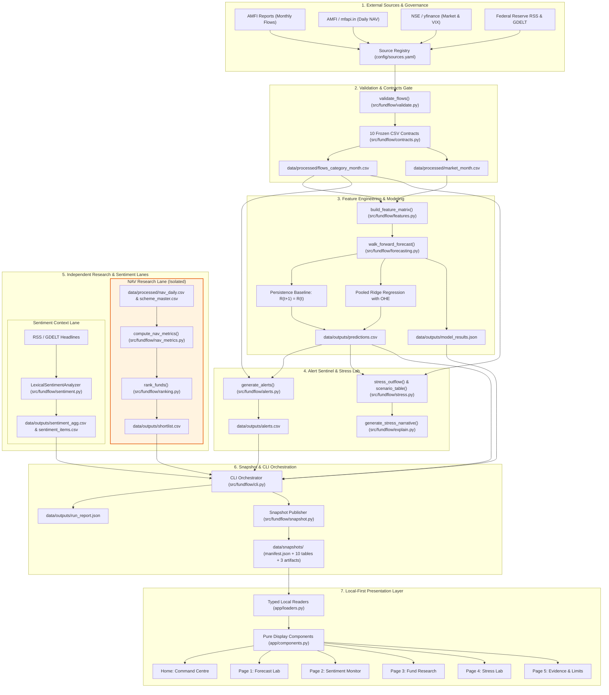

# FundFlow Sentinel — Implemented System Architecture

This document specifies the technical architecture, data flows, subsystem boundaries, and quantitative invariants implemented in FundFlow Sentinel.

---

## 1. End-to-End System Architecture

---

## 2. Subsystem Descriptions & Boundaries

### 1. Source Governance & Registry (`config/sources.yaml`, `src/fundflow/registry.py`)
* Tracks 13 external and synthetic data sources.
* Enforces strict redistribution boundaries: third-party raw/processed data subject to restricted redistribution terms (AMFI, NSE, Yahoo Finance) are excluded from public snapshots.
* Prohibits commercial-only transformer model weights (FinBERT) from being bundled in the repository.

### 2. Contract Validation Gate (`src/fundflow/contracts.py`, `src/fundflow/validate.py`)
* Enforces 10 frozen CSV schemas with exact column order, types, and units:
  * `flows_category_month` (10 cols, INR crore)
  * `market_month` (8 cols)
  * `feature_matrix` (17 cols)
  * `predictions` (11 cols)
  * `alerts` (16 cols)
  * `nav_daily` (4 cols)
  * `scheme_master` (7 cols)
  * `shortlist` (15 cols)
  * `sentiment_items` (13 cols)
  * `sentiment_agg` (6 cols)
* Validates canonical category mappings across 6 universe categories (`Large Cap`, `Flexi Cap`, `Mid Cap`, `Small Cap`, `Corporate Bond`, `Aggressive Hybrid`) and 2 exclusions (`Liquid`, `Overnight`).

### 3. Feature Engineering & Forecasting (`src/fundflow/features.py`, `src/fundflow/forecasting.py`)
* **Feature Engineering:** Builds leakage-safe autoregressive flow lags (lag 0, 1, 2, 11), rolling means, rolling volatility, and macroeconomic market returns/volatility indicators.
* **Forecasting Models:**
  * *Persistence Baseline:* $R_{t+1} = R_t$ (last observed redemption rate).
  * *Pooled Ridge Regression:* One-hot category encoded Ridge regression with hyperparameter $\alpha \in [0.1, 1.0, 10.0, 100.0]$ tuned via inner `TimeSeriesSplit` on training folds only.
* **Leakage Invariants:** All scalers fit inside training folds. Out-of-sample evaluation strictly satisfies `train_end < target_month`. Future data strictly after month $T$ cannot mutate features for month $T$.

### 4. Alert Sentinel & Stress Lab (`src/fundflow/alerts.py`, `src/fundflow/stress.py`, `src/fundflow/explain.py`)
* **Hierarchical Alert Rules:**
  * *Critical:* Forecast rate $\ge 90\text{th}$ percentile AND (Robust $Z \ge 2.0$ OR 3-month momentum $\ge 0.10$).
  * *Elevated:* Forecast rate $\ge 75\text{th}$ percentile.
  * *Normal:* Default baseline state.
* **Zero-MAD Safeguard:** When median absolute deviation (MAD) is zero, robust Z-scores default safely to zero without divide-by-zero errors.
* **Stress Outflow Arithmetic:** Computes reference AUM proxies, incremental stress outflows, and enforces an absolute upper cap at 100% of reference AUM.

### 5. Isolated NAV Research Lane (`src/fundflow/ranking.py`, `src/fundflow/nav_metrics.py`)
* **Complete Architectural Isolation:** Verified via AST analysis that `src/fundflow/ranking.py` and `src/fundflow/nav_metrics.py` import zero modules from forecasting, alerts, stress, or flow modeling.
* **Universe Eligibility:** Filters strictly for Direct Plan, Growth Option schemes with $\ge 750$ calendar days of continuous daily NAV history ($\le 10$-day gap tolerance).
* **Composite Ranking Formula:**
  $$\text{Score} = 0.40 \cdot P_{\text{CAGR}} + 0.20 \cdot P_{\text{Vol}} + 0.20 \cdot P_{\text{Drawdown}} + 0.10 \cdot P_{\text{Sortino}} + 0.10 \cdot P_{\text{Consistency}}$$
  Drawdown percentile is inverted so that smaller losses receive higher ranks.

### 6. Sentiment Context Lane (`src/fundflow/sentiment.py`, `src/fundflow/ingest/gdelt.py`)
* Evaluates news tone using a verified local lexical classifier (`model_id="lexical-finance-v1"`).
* Preserves separate publication vs retrieval timestamps.
* Enforces a minimum sufficiency threshold of 30 articles per period (`status="insufficient_data"` if $<30$).
* Operates strictly as contextual intelligence; never used as a quantitative input for fund ranking.

### 7. CLI Orchestration & Snapshot Publisher (`src/fundflow/cli.py`, `src/fundflow/snapshot.py`)
* Provides deterministic subcommands: `build-data`, `train`, `alerts`, `sentiment`, `rank`, `all`, and `snapshot`.
* Executes transactional file writes via temporary `.tmp` staging, contract validation, and atomic filesystem renames.
* Preserves last-known-good outputs upon any stage failure.
* Publishes compact, licence-safe offline demo snapshots under `data/snapshots/`.

### 8. Presentation Layer (`app/loaders.py`, `app/components.py`, `app/`)
* Consumes data exclusively through typed local loaders (`load_table`, `load_artifact`).
* UI components perform zero machine learning inference, ranking calculations, or mathematical transforms.
* Unconditionally displays visible `SYNTHETIC DEMO DATA` warnings on fixture bundles.

---

## 3. Component Status Matrix

| Component / Module | Implemented | Status | Evidence / Notes |
|---|---|---|---|
| Contract Schema Validation | Yes | **Production** | [`src/fundflow/contracts.py`](file:///Users/anny/Desktop/mutual-fund/src/fundflow/contracts.py); 32 contract tests passing |
| AMFI Flow Parsing & Validation | Yes | **Production** | [`src/fundflow/ingest/amfi_flows.py`](file:///Users/anny/Desktop/mutual-fund/src/fundflow/ingest/amfi_flows.py), [`src/fundflow/validate.py`](file:///Users/anny/Desktop/mutual-fund/src/fundflow/validate.py) |
| Daily NAV Ingestion | Yes | **Production** | [`src/fundflow/ingest/amfi_nav.py`](file:///Users/anny/Desktop/mutual-fund/src/fundflow/ingest/amfi_nav.py), [`src/fundflow/ingest/mfapi.py`](file:///Users/anny/Desktop/mutual-fund/src/fundflow/ingest/mfapi.py) |
| Market Data Ingestion | Yes | **Production** | [`src/fundflow/ingest/market.py`](file:///Users/anny/Desktop/mutual-fund/src/fundflow/ingest/market.py); NIFTY & VIX indicators |
| Leakage-Safe Feature Matrix | Yes | **Production** | [`src/fundflow/features.py`](file:///Users/anny/Desktop/mutual-fund/src/fundflow/features.py); lagged flow & macro features |
| Ridge & Persistence Forecasting | Yes | **Production** | [`src/fundflow/forecasting.py`](file:///Users/anny/Desktop/mutual-fund/src/fundflow/forecasting.py); walk-forward cross-validation |
| Hierarchical Alert Sentinel | Yes | **Production** | [`src/fundflow/alerts.py`](file:///Users/anny/Desktop/mutual-fund/src/fundflow/alerts.py); Critical/Elevated/Normal rules |
| Stress Outflow Calculator | Yes | **Production** | [`src/fundflow/stress.py`](file:///Users/anny/Desktop/mutual-fund/src/fundflow/stress.py); 100% asset capping |
| Finance-Safe Narrative Engine | Yes | **Production** | [`src/fundflow/explain.py`](file:///Users/anny/Desktop/mutual-fund/src/fundflow/explain.py); objective prose generator |
| Standalone NAV Fund Ranking | Yes | **Production** | [`src/fundflow/ranking.py`](file:///Users/anny/Desktop/mutual-fund/src/fundflow/ranking.py); AST-verified isolation |
| Lexical Sentiment Analyzer | Yes | **Production** | [`src/fundflow/sentiment.py`](file:///Users/anny/Desktop/mutual-fund/src/fundflow/sentiment.py); local finance lexicon |
| CLI Orchestration Engine | Yes | **Production** | [`src/fundflow/cli.py`](file:///Users/anny/Desktop/mutual-fund/src/fundflow/cli.py); atomic writes & telemetry |
| Offline Snapshot Publisher | Yes | **Production** | [`src/fundflow/snapshot.py`](file:///Users/anny/Desktop/mutual-fund/src/fundflow/snapshot.py); transactional manifest & hashes |
| Streamlit Presentation Shell | Yes | **Production** | 6 complete pages under [`app/`](file:///Users/anny/Desktop/mutual-fund/app/); offline socket-blocked verification |
| FinBERT Neural Weights | No | **Excluded** | Restricted non-commercial license; lexical fallback deployed |
| Multi-Year Empirical Residual Bands | No | **Insufficient Data** | Empirical flows cover 1 month (`2024-09`); bands withheld |
| Real-Time Live Websockets | No | **Out of Scope** | Batch monthly flows and daily NAV; live streaming not supported |
