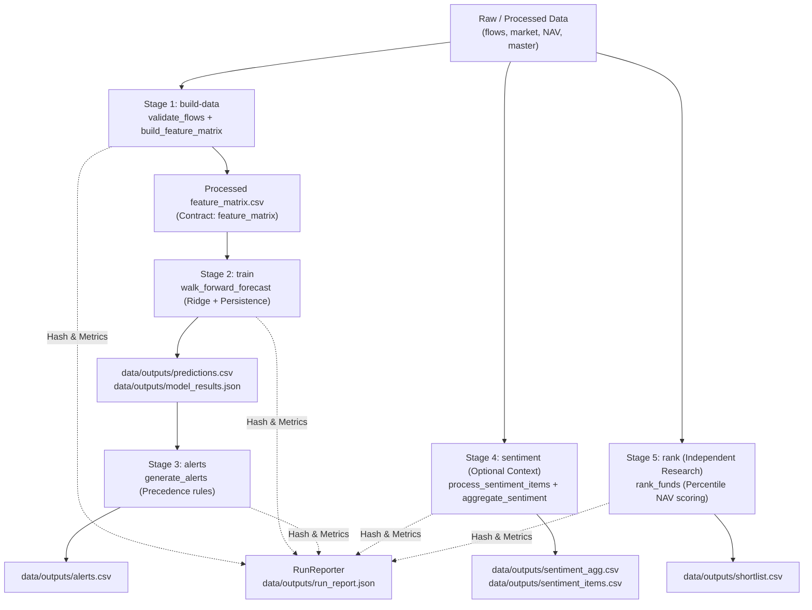

# FundFlow CLI Orchestration & Machine-Readable Run Reporting

**Module:** `src/fundflow/cli.py` & `src/fundflow/reporting.py`  
**Owner:** Agent A (Platform & Execution)  
**Status:** Approved & Implemented (Wave 10)  

---

## 1. Overview & Operational Architecture

FundFlow Sentinel provides a deterministic, contract-validated CLI orchestration pipeline. The pipeline coordinates the transformation of raw/processed data into feature matrices, trained walk-forward forecasts, hierarchical redemption alerts, context sentiment signals, and independent fund research shortlists.



---

## 2. CLI Subcommands

| Subcommand | Purpose | Required Inputs | Produced Outputs | Validation Gate |
|---|---|---|---|---|
| `build-data` | Leakage-safe feature matrix assembly | `flows_category_month.csv`<br>`market_month.csv` | `data/processed/feature_matrix.csv` | `validate_flows`<br>`validate_table('feature_matrix')` |
| `train` | Walk-forward expanding-window forecast | `feature_matrix.csv` | `data/outputs/predictions.csv`<br>`data/outputs/model_results.json` | `validate_table('predictions')`<br>JSON results envelope schema |
| `alerts` | Hierarchical anomaly & stress alerts | `predictions.csv`<br>`flows_category_month.csv` | `data/outputs/alerts.csv` | `validate_table('alerts')` |
| `sentiment` | Context monitoring & topic sentiment | `sentiment_items.csv` (or RSS feed) | `data/outputs/sentiment_items.csv`<br>`data/outputs/sentiment_agg.csv` | `validate_table('sentiment_items')`<br>`validate_table('sentiment_agg')` |
| `rank` | Independent NAV research ranking | `nav_daily.csv`<br>`scheme_master.csv` | `data/outputs/shortlist.csv` | `validate_table('shortlist')` |
| `all` | End-to-end coordinated pipeline | All required inputs | Complete artifact bundle + `run_report.json` | All stage contracts |

---

## 3. Global Options & Flags

* `--data-dir PATH`: Root data directory containing `processed/` and `snapshots/fixtures/` (default: `<repo_root>/data`).
* `--output-dir PATH`: Directory for outputs (`predictions`, `alerts`, `shortlist`, etc., default: `<repo_root>/data/outputs`).
* `--report-file PATH`: Custom destination for the run report JSON (default: `<output-dir>/run_report.json`).
* `--offline`: Explicitly enforces offline execution; skips live RSS feeds and suppresses socket connections.
* `--min-train-months INT`: Minimum training window for walk-forward evaluation (default: `36`).
* `--verbose` / `-v`: Emits stage-by-stage diagnostics and execution timing to stdout.

---

## 4. Fault Tolerance & Atomic Write Guarantees

Every stage enforces the **atomic write and last-known-good preservation invariant**:
1. **In-Memory Validation**: Output data structures are verified against frozen schemas (`validate_table`) prior to any disk modification.
2. **Temporary File Pattern**: New outputs are written to temporary staging files (`<filename>.tmp`).
3. **Atomic POSIX Rename**: Staged files replace target files atomically using `os.replace`.
4. **Preservation on Failure**: If any exception or schema validation error occurs, the temporary file is deleted, the last-known-good file remains unmodified, and the failure is logged to `run_report.json`.

---

## 5. Machine-Readable Run Report Specification

Each execution generates a self-contained, audit-grade JSON envelope (`run_report.json`):

```json
{
  "version": 1,
  "run_id": "run_20261028_190419_20043",
  "generated_at": "2026-10-28T19:04:19Z",
  "start_time": "2026-10-28T19:04:19Z",
  "end_time": "2026-10-28T19:04:19Z",
  "duration_seconds": 0.85,
  "status": "partial_success",
  "git_commit": "e8a1f2b...",
  "environment": {
    "python_version": "3.11.16",
    "platform": "macOS-27.2-arm64-arm-64bit"
  },
  "cli_args": {
    "subcommand": "all",
    "offline": true
  },
  "summary": {
    "total_stages": 5,
    "successful_stages": 5,
    "failed_stages": 0,
    "skipped_stages": 0,
    "warnings_count": 1,
    "errors_count": 0
  },
  "stages": {
    "build-data": {
      "status": "success",
      "duration_seconds": 0.21,
      "inputs": {
        "flows_category_month": {
          "sha256": "c4598dea...",
          "size_bytes": 1712,
          "rows": 8
        }
      },
      "outputs": {
        "feature_matrix": {
          "sha256": "d99a1e95...",
          "size_bytes": 210,
          "rows": 0
        }
      }
    }
  },
  "limitations": [
    "Dataset span is insufficient for 36-month warm-up."
  ]
}
```

---

## 6. Makefile Integration Proposal

The following targets are proposed for incorporation into `Makefile`:

```makefile
run:
	$(PYTHON) -m fundflow.cli --offline all

build-data:
	$(PYTHON) -m fundflow.cli build-data

train:
	$(PYTHON) -m fundflow.cli train

alerts:
	$(PYTHON) -m fundflow.cli alerts

rank:
	$(PYTHON) -m fundflow.cli rank

pipeline:
	$(PYTHON) -m fundflow.cli --offline all
```
